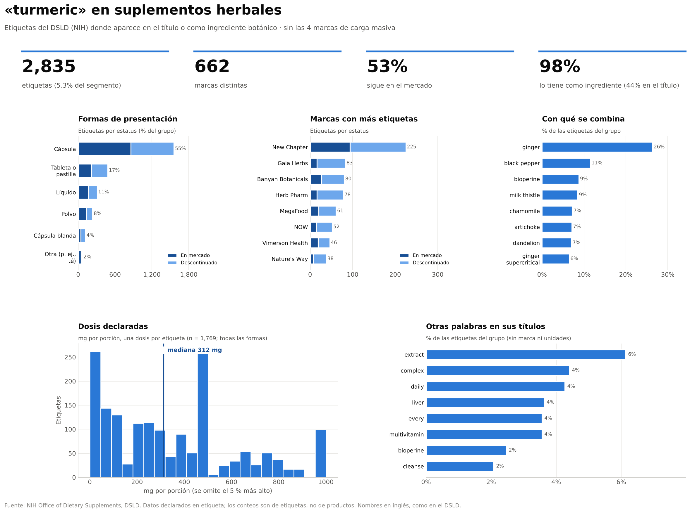

# 02 · Buscador de suplementos herbales

Notebook: `DSLD_buscador_herbal.ipynb`. Escribes una palabra o un ingrediente (en inglés) y genera un dashboard con todas las etiquetas herbales que lo contienen.



## Qué necesita

`MyDrive/dsld/DSLD-full-database-CSV.zip`. No necesita el JSON.

## Cómo se usa

1. Abre el notebook en Colab y ejecuta todas las celdas (tarda lo que tarda cargar el CSV).
2. Al final aparece una caja: escribe un término, elige dónde buscar y pulsa **Generar dashboard** (o Enter).
3. También puedes llamar la función directamente en una celda:

```python
dashboard("turmeric")                          # ingrediente o título
dashboard("immune", donde="titulo")            # solo en el título
dashboard("ginger", sin_carga_masiva=False)    # incluye las 4 marcas de carga masiva
dashboard("saw palmetto", max_filas=50)        # más filas en la tabla
```

| Parámetro | Qué hace |
|---|---|
| `termino` | Palabra o frase, en inglés. Busca palabras completas |
| `donde` | `"ambos"` (por defecto), `"ingrediente"` o `"titulo"` |
| `sin_carga_masiva` | Por defecto `True`: excluye TerraVita Premium Collection, TerraVita, Herbal Terra y Hawaii Pharm |
| `max_filas` | Cuántos productos muestra la tabla (todos se guardan en CSV) |

## Qué muestra el dashboard

- Cuatro indicadores: número de etiquetas (y su peso en el segmento), marcas distintas, porcentaje en el mercado y cuántas lo tienen como ingrediente frente a solo en el título.
- **Formas de presentación** y **marcas** con más etiquetas, por estatus de mercado.
- **Con qué se combina:** los ingredientes botánicos que más lo acompañan.
- **Dosis declaradas** (histograma y mediana), si el término es un ingrediente con dosis en mg.
- **Otras palabras en sus títulos.**
- Una tabla con los productos (producto, marca, forma, estatus, año de entrada).

## Qué guarda

En `MyDrive/dsld/salida/busquedas/`: `figuras/dashboard_<termino>.png` y `tablas/productos_<termino>.csv` (lista completa).

## Ejemplos

- `ejemplos/dashboard_turmeric.png`: un ingrediente, con dosis.
- `ejemplos/dashboard_immune.png`: una palabra de título; el panel de dosis lo avisa porque casi no es un ingrediente.

## Limitaciones

- Busca **palabras completas en inglés**, sin sinónimos (*sambucus* y *elderberry* son búsquedas distintas). Si no hay resultados, sugiere nombres parecidos.
- Los ingredientes se buscan en nombres **limpiados** (sin *extract*, *root*, *organic*…), así que `turmeric root extract` cuenta como `turmeric`.
- Las dosis son por porción y mezclan formas.
- Los conteos son de etiquetas, no de productos distintos.
