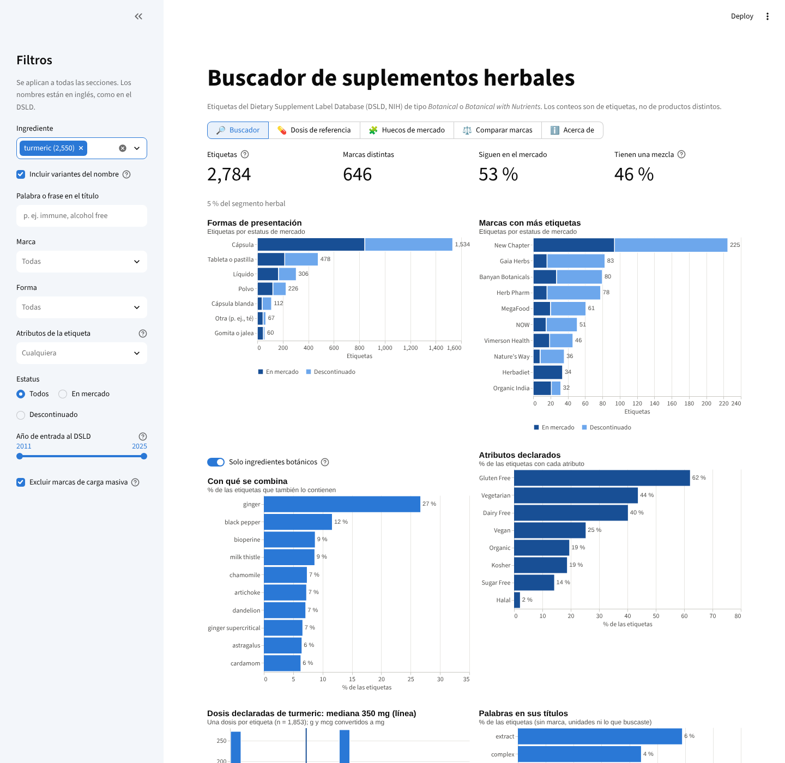
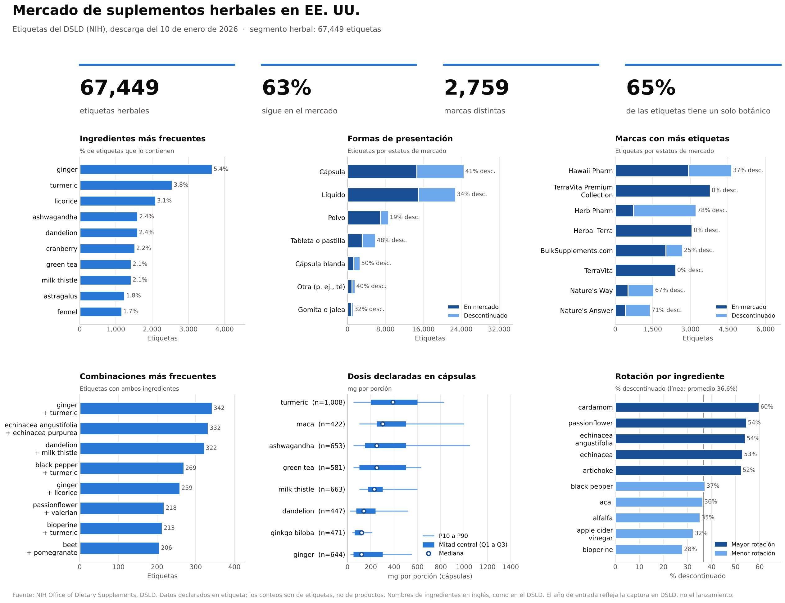

# Suplementos herbales en EE. UU. · Herbal supplements in the U.S.

**English summary.** Data analysis project on the NIH [Dietary Supplement Label Database (DSLD)](https://dsld.od.nih.gov/), focused on the **67,449 herbal supplement labels** sold in the U.S. It includes (1) a Python analysis of ingredients, formats, brands, blends, doses and product-name keywords, (2) a notebook that builds a dashboard for any ingredient or keyword, and (3) an interactive **Streamlit app** for product developers: search by ingredient, title keyword, brand, form or label claim (vegan, organic…), get reference dose ranges by form, spot ingredient × form gaps, and compare brands. Built with Python, pandas, matplotlib, Altair and Streamlit.

**App:** [abrir el buscador](https://TU-APP.streamlit.app) <!-- reemplaza con el link de tu app -->



## Qué hay aquí

```
├── app/                       ← app de Streamlit (buscador para desarrollo de producto)
│   ├── app.py
│   ├── datos/                 ← datos ya preparados en Parquet (~5 MB)
│   └── capturas/
├── notebooks/
│   ├── 01_analisis_herbal/    ← análisis completo: 10 análisis + dashboard (Colab)
│   └── 02_buscador_herbal/    ← dashboard automático por palabra o ingrediente (Colab)
├── utilidades/
│   ├── dsld_extract_json.py   ← extrae campos del JSON del DSLD
│   └── preparar_datos.py      ← genera los Parquet de la app
├── requirements.txt           ← dependencias de la app
└── DESPLIEGUE.md              ← cómo publicar la app gratis en Streamlit Community Cloud
```

## La app

Pensada para **desarrollo de producto**. Los filtros de la barra lateral (ingrediente, palabra del título, marca, forma, atributos, estatus y año) se aplican a cuatro secciones:

- **Buscador:** indicadores, formas, marcas, con qué se combina, atributos declarados, dosis y palabras de los títulos, más la lista de productos con link a la etiqueta original y descarga en CSV.
- **Dosis de referencia:** rango de dosis declaradas de un ingrediente por forma (P10, Q1, mediana, Q3, P90).
- **Huecos de mercado:** mapa ingrediente × forma con el número de etiquetas; las celdas claras son combinaciones poco exploradas.
- **Comparar marcas:** hasta tres marcas lado a lado (formas, atributos e ingredientes principales).

Para correrla en tu computadora:

```bash
pip install -r requirements.txt
streamlit run app/app.py
```

## Hallazgos principales del análisis

- El segmento herbal tiene **67,449 etiquetas** (63 % en el mercado) y está muy fragmentado: ningún ingrediente supera el 6 % de las etiquetas, y 38 % de las marcas tiene una sola.
- 65 % de las etiquetas contiene un solo botánico. Las combinaciones más frecuentes son clásicas: jengibre + cúrcuma, cúrcuma + pimienta negra, pasiflora + valeriana.
- Las dosis declaradas se agrupan en valores redondos (250, 300, 500 mg).
- Las mezclas (27 % de las etiquetas) abundan en tabletas (42 %) y líquidos (35 %) y casi no aparecen en polvos (15 %).
- En los títulos, «extract» aparece en 11.6 % de las etiquetas, más de tres veces que «root» u «organic».
- Entre las etiquetas que se registran cada año, **lo vegano pasa de 11 % (2012) a 28 % (2025)** y **lo «sin azúcar» baja de 43 % (2016) a 9-15 % (2024-2025)**.



## Cómo reproducir el análisis

Los notebooks corren en Google Colab con la descarga completa del DSLD en tu Drive:

```
MyDrive/dsld/DSLD-full-database-CSV.zip
MyDrive/dsld/DSLD-full-database-JSON.zip
```

Abre `notebooks/01_analisis_herbal/DSLD_herbal_analisis.ipynb` en Colab y ejecuta todo. El detalle está en el README de cada carpeta.

Para regenerar los datos de la app (por ejemplo, con una descarga más reciente del DSLD):

```bash
python utilidades/dsld_extract_json.py DSLD-full-database-JSON.zip dsld_json_extra.csv
python utilidades/preparar_datos.py DSLD-full-database-CSV/ dsld_json_extra.csv
```

## Decisiones de análisis que conviene conocer

- **Segmento herbal:** etiquetas de tipo *Botanical* o *Botanical with Nutrients*.
- **Cargas masivas:** cuatro marcas (TerraVita Premium Collection, TerraVita, Herbal Terra y Hawaii Pharm) subieron 13,933 etiquetas por lotes y distorsionan algunos resultados; la app las excluye por defecto.
- **Año de entrada ≠ lanzamiento:** es la fecha en que se capturó la etiqueta en el DSLD.
- **Etiquetas, no productos:** una misma presentación puede tener varias etiquetas (tamaños, sabores).
- **Nombres de ingredientes:** se limpian de forma aproximada (*turmeric root extract* cuenta como *turmeric*).

## Limitaciones

- Los datos son lo **declarado en etiquetas**; el NIH no verifica su exactitud.
- No hay ventas ni demanda: el proyecto describe qué existe, no qué se vende ni qué funciona.
- Son datos de EE. UU.; no equivalen al mercado mexicano.

## Fuente de los datos

NIH Office of Dietary Supplements, Dietary Supplement Label Database (DSLD), descarga completa de enero de 2026 (214,780 etiquetas). La app incluye un subconjunto ya procesado del segmento herbal.
